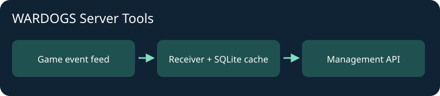

# WARDOGS Server Tools

[简体中文](README.zh-CN.md) · [Operations](docs/OPERATIONS.md) · [AI workflow](AGENTS.md)

Python management API, event receiver and local cache for a self-managed WARDOGS server. The original server has shut down and this source snapshot is archived. The [AstrBot plugin](https://github.com/RhoninSeiei/astrbot_plugin_wardogs_archive) is distributed separately.



Use Python 3.11 or newer. Create private `data` and `secrets` directories, put your RCON token into `secrets/rcon`, and generate a fresh service token.

```sh
mkdir -p data secrets
chmod 700 data secrets
umask 077
python -c 'import secrets; print(secrets.token_urlsafe(32))' > secrets/service
CONFIG_FILE=service/config.example.json API_KEY_FILE=secrets/service STATE_DB=data/state.db RCON_HOST=127.0.0.1 RCON_PORT=10246 RCON_KEY_FILE=secrets/rcon API_PORT=18761 python -m service.app
```

Replace the RCON host and port with your own. Check `GET /healthz` and then verify an authenticated read against the game. The example disables automated sanctions and notifications. See the [API specification](service/openapi.json) and operations guide for running the receiver and cache.

Apache-2.0 licensed.
