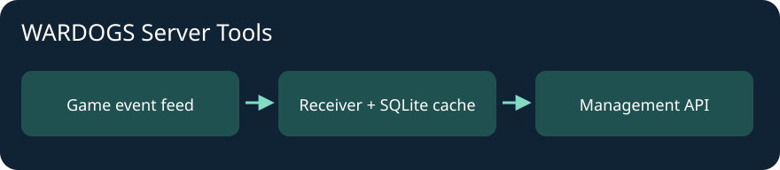

# WARDOGS 服务器工具

[English](README.md) · [运维手册](docs/OPERATIONS.md) · [AI 工作流](AGENTS.md)

面向自管 WARDOGS 服务器的 Python 管理接口、事件接收器和本地缓存。原社区服务器已停运，两份源码均作为最终公开归档保存。[AstrBot 插件](https://github.com/RhoninSeiei/astrbot_plugin_wardogs_archive)单独发布。

使用 Python 3.11 或以上版本。参考英文 README 的启动命令，创建私有数据和令牌目录，设置自有 RCON 地址与端口。示例配置关闭自动处罚和通知。启动后先检查 `GET /healthz`，再用查询令牌验证真实数据更新。事件接收、缓存和管理员范围的配置见运维手册。

采用 Apache-2.0 许可证。
